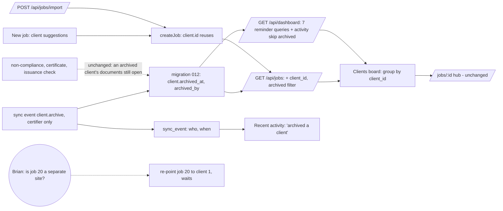

# Change graph: a clean landing for Brian (16 October 2026)

Source: owner, in chat, 16 Oct 2026: "it will be nice for Brian when log in to
see clean active clients than to see ugly landing page". Method: graph
approach, with Fable as design adviser; inspected locally and read-only on live
before anything was decided.

## 1. The ask

| # | Ask |
|---|---|
| C1 | On sign-in Brian lands on his **active clients**, clean, not the current landing |
| C2 | (implied) What he sees is real work, not test residue |

## 2. Today (what the system does, with evidence)

| Node | Today | Where |
|---|---|---|
| Landing route | `/` renders `JobsBoard`; login redirects to `/` | `apps/mobile/lib/app.dart:123-126`, `:114` |
| Board content | Header "N of M jobs" + Active / Certificate issued / All chips + New job; amber **Needs attention** card (shown even when empty); **Recent activity** card (8 events); then one full-width card **per job** | `apps/mobile/lib/screens/jobs_board.dart:301-329` |
| Unit of the list | The **job**, not the client. A client with two locations shows twice | `jobs_board.dart:325`, `/api/jobs` `apps/server/src/app.mjs:267-297` |
| Layout on a desk screen | Cards stretch the full 1565 px; name far left, stage chip far right, mostly white space | screenshot, local, 16 Oct |
| "Active" | stage not in closed / referred / monitoring | `jobs_board.dart:46` |
| Creating a job | `createJob` **always inserts a new client row**; no client picker, no clients screen | `app.mjs:301-307`; also used by `/api/jobs/import` `app.mjs:930` |
| Client readers | `/api/jobs`, `/api/jobs/:id`, issuance check, dashboard (8 queries), non-compliance report | `app.mjs:278, 413, 621, 791-841, 867` |
| Tests on the board | `widget_test.dart:150-152` expect keys `attention` and `activity` | `apps/mobile/test/widget_test.dart` |

## 3. Found while reading (nobody asked)

- **F1. Live is mostly demo data.** Read-only check on 16 Oct: 19 jobs; 17 belong
  to clients named "Demo … Limited" (11 to 13 Sept, test and demo runs). Only
  Argenta is real. This is most of what makes the landing "ugly".
- **F2. Argenta is two clients.** Job 1 "Argenta Manufacturing Limited / G2
  Chiller / 2 Sterling Avenue…" and job 20 "Argenta / G2 Chiller / 1d Matakohe"
  are separate client rows. "Demo Multi-User Limited / Store room 3" is also
  duplicated (jobs 17, 18). Root cause: F3.
- **F3. Every New job makes a new client** (`app.mjs:302`). The same company
  entered twice becomes two clients, so a client-first view would show duplicates
  until this is fixed.
- **F4. The empty "Needs attention" card** takes a band of amber to say nothing.
- **F5. Project `CLAUDE.md` describes the retired stack** (Express + SQLite +
  Railway, `apps/api`, `apps/web`); the running app is `apps/server` + Flutter
  `apps/mobile`. Misleads any agent that reads it first.

## 4. The graph

| Ask | Today | Change | Size |
|---|---|---|---|
| C1 clients, clean | Flat job cards, full width, empty amber card | `/` becomes **Clients**: one row per client (grouped by `client_id`), its open jobs as lines under it; content max 960 px; Needs attention only when there is something; Recent activity last, 5 lines | M |
| C2 real work only | 17 demo jobs on live | `client.archived_at`; certifier archives a client from its row; archived clients leave the board and every reminder; "Show archived (n)" brings them back | M |
| F3 duplicates | New job always inserts a client | New job's legal name field suggests existing clients; picking one sends `client.id`, no new row | S |
| F5 | stale CLAUDE.md | rewrite to the running stack | S |

Readers of `client` (all checked): `/api/jobs` (filter), `/api/dashboard` (filter all
8 queries), `/api/jobs/:id`, issuance check, certificate, non-compliance report
(**not** filtered: an archived client's job still opens by URL and its
documents still print; archive hides, it does not remove).

## 5. Decisions (each reversible) and questions

- **B1. Archive, never delete.** Additive `client.archived_at` / `archived_by`.
  Why: deleting live rows needs per-row authorisation, loses the audit trail,
  and `job.client_id` has no cascade (`002_instance_layer.sql:136`). Reverse:
  Unarchive, or drop the column.
- **B2. Archive is a sync event (`client.archive`, `{clientId, archived}`),
  certifier only.** Why: every other mutation goes through the event log with
  the person attached (IPS 21(5)); it shows in Recent activity and replays
  safely. Reverse: the same event with `archived: false`.
- **B3. An active client** has at least one job not closed or referred (a
  monitoring job is a certified client Brian still looks after). The "Show
  archived" link is the only filter left; the Active / Certificate issued / All
  chips go. Reverse: put the chips back; they were client-side only.
- **B4. Group by `client_id`, not by name**, so the two Argentas show as two
  rows and the duplicate stays visible until Brian answers Q1.
- **B5. New job reuses a client when one is picked; typing a new name still
  creates one.** No unique index on legal name (renamed entities are re-certified).
- **B6. The "Load G2 Chiller (workbook)" demo button** on an empty board stays
  only in a build with `--dart-define=DEMO=true`, so a demo is never seeded on
  production again.
- **B7. The demo clients are archived on live only on the owner's word**,
  through the app, after deploy. No SQL.

Questions for Brian (do not block this phase):
1. Job 20 "Argenta, G2 Chiller, 1d Matakohe": the same company as job 1
   (Argenta Manufacturing Limited, 2 Sterling Avenue), a second site, or a test?
   Today they show as two clients.
2. On the client list, lead with the legal name (today) or the trading name?

## 6. Phases

- **Phase 1 (now, no answers needed):** B1 to B6, tests, local proof. No deploy.
- **Phase 2 (on the owner's word):** deploy; archive the 15 demo clients in the
  app; act on Q1.

## 7. Built (phase 1)

| Piece | Where |
|---|---|
| Migration 012 `client.archived_at`, `archived_by` (additive, nullable) | `packages/db/migrations/012_client_archive.sql` |
| Sync event `client.archive` (certifier only; boolean `archived`; id shape-checked) | `apps/server/src/sync/apply.mjs`, `roles.mjs` |
| `/api/jobs`: `client_id`, `client_archived`, `?archived=1` | `apps/server/src/app.mjs` |
| `/api/dashboard`: all 7 reminder queries and activity skip archived clients; the archive event names its client | `app.mjs` |
| New job: `client.id` reuses an unarchived client (strict id, `FOR SHARE`); import always makes its own | `app.mjs` |
| Clients landing, archive / Undo / Bring back, client suggestions in New job, 960 px column, attention only when non-empty, activity last | `apps/mobile/lib/screens/jobs_board.dart` |
| "archived a client" / "brought a client back to the list" in activity; hub link reads "Clients" | `models/dashboard.dart`, `job_screen.dart`, `checksheet_screen.dart`, `people_screen.dart` |
| Demo loader only with `--dart-define=DEMO=true` | `jobs_board.dart` |
| CLAUDE.md rewritten to the running stack (F5) | `CLAUDE.md` |

## 8. Proof (16 October 2026, local only; nothing deployed, live untouched)

- Tests written first and seen red: server `clients.test.mjs` (8 of 10 red),
  Flutter `clients_board_test.dart` (10 of 12 red).
- **Server suite:** 9 files, all green (api.e2e 29, revision-pin 5,
  process-flow 10, auth 8, loops 10, forms 6, users 6, review 9, clients 15).
- **Flutter:** `flutter analyze` (2 pre-existing notices, none new), `flutter
  test` 77 passed, 2 skipped (live tests, need `LIVE_API`). The one old test
  that broke asserted the old "No jobs yet" wording; updated to the new copy.
- **Swarm:**
  - Fable advised the design (client-first, archive not delete, picker).
  - A code reviewer found 4 medium defects (archive success misreported
    during an in-flight sync; Undo after leaving the board; a 500 from
    import; the raw `client.archive` in activity). All fixed, each with a test.
  - An adversarial API tester on its own server checked roles, 19 hostile
    ids, replay, every reminder kind it could produce, read-through, and 300
    jobs / 60 clients. `/api/jobs` median 14 ms, `/api/dashboard` 21 ms.
    Loose id coercion (`true`, `[1]`, `"0x1"`) and a non-boolean `archived`:
    fixed and tested.
  - A browser tester walked sign-in, archive / Undo / Bring back, the client
    picker (Argenta became one card with two jobs; the count held) at desktop,
    iPad and phone widths. Form spacing, SnackBar persistence and the "Jobs"
    label were fixed after it; re-checked in the browser.
- **Not verified:** the live Neon migration (runs on first request after
  deploy; additive, so the old code keeps working); a real iPad; email.

## 9. Open (for the owner)

- **B8. Writes on an archived client's job still apply** (findings, stage
  moves, even a certificate). That matches "archive hides, does not remove",
  but a stale device could keep working on a hidden client. If archive should
  mean "not real work", the next step is refusing new events for archived
  clients. Not built; owner's call.
- Deploy, then archive the demo clients from the app: the owner's word, each.
- Q1 and Q2 for Brian, above.
