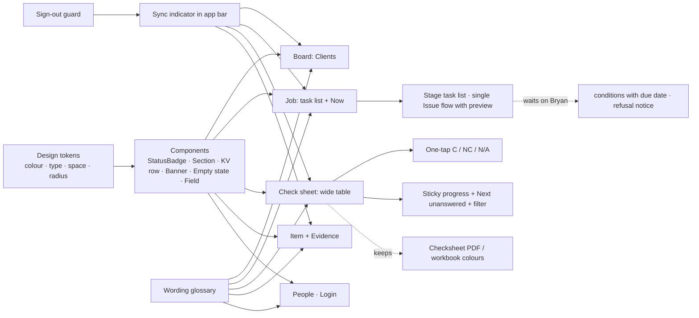

# Look, feel and user experience: change graph (19 Oct 2026)

Request (owner, 19 Oct 2026): "work on the look and feel of this application and user experience · use the graph approach · borrow from the best platforms at global level · use any skills available including Claude Design."

Inputs: a screen walk on a local copy seeded with the three replayed past jobs (G2 Chiller refused/granted, Abecca conditional); a code audit of `apps/mobile/lib` (every claim below has file:line); research of SafetyCulture, Procore, Fulcrum, Linear, Stripe, GOV.UK / NZ Government design system, Material 3 and Apple's iPad guidance in [RESEARCH.md](RESEARCH.md).

## 1. Asks

| # | Ask (owner's words, short) |
|---|---|
| C1 | Look and feel: the app should look like a best-in-class product |
| C2 | User experience: fewer steps, less friction for Bryan on site and in the office |
| C3 | Borrow proven patterns from global platforms |
| C4 | Use the design skills available (Claude Design) to show the direction before building |

Standing constraint (scope of work, 19 Oct): the check sheet and its PDF **follow the workbooks**: same words, same order, red = finding, green = compliant, blue = general comment.

## 2. Today

| Area | Today | Evidence |
|---|---|---|
| Design system | `useMaterial3` + teal seed, but text styles are literals: 12 font sizes (10.5–17), 15 near-identical greys, 106 hard-coded colours, 6 radii, no spacing scale, no dark mode | `lib/theme.dart:39-77`; audit §1 |
| Type size | Most text 11–12.5px; too small for an iPad held on site | screen walk; 48× size 12, 21× size 11 |
| Width | Board is a 960px column; job and sheet span the full width | `jobs_board.dart`, `job_screen.dart` |
| Headers | Two header styles (white BrandBar vs teal AppBar on Item/Evidence); job title, subtitle and context bar repeat the same client/location | `brand_bar.dart:56`, `item_screen.dart:98`, `job_screen.dart:126-136` |
| Sheet chrome | ~300px of header, progress, chips, sync and jump bar before the first item (≈40% of iPad landscape) | `checksheet_screen.dart:103`, `sheet_view.dart:138` |
| Answering an item | Wide sheet: an 11px "C ▾" dropdown; narrow: tile → item screen → chips | `sheet_view.dart:484`, `item_screen.dart:158` |
| Job screen | 10 stacked cards, no in-page navigation; "Issue certificate" and "Open certificate" each appear twice | `job_screen.dart:160-174, 264/877, 270/902` |
| Dialogs | New job 11+ fields, silently closes when required fields are empty; dates typed as YYYY-MM-DD | `jobs_board.dart:143-319`, `job_screen.dart:795, 963` |
| Feedback | No confirmation after send, issue, attach, people actions; a queued (offline) event shows as an error with a gavel icon | `job_screen.dart:94-113, 581, 1000, 102/182` |
| Sync status | Only on the check sheet | `checksheet_screen.dart:237-283` |
| Wording | Same thing, many names: "Cannot grant yet" / "Cannot issue"; "Check sheet" / "Checksheet"; three names for the N/C reason; internal codes shown ("wks17-general 6/2", "minor", "open") | audit §4 |
| Accessibility | No Semantics; white text on #00B050 / #E68A00 / #BDBDBD fails contrast; black38/45 hint text fails; several statuses are colour only; touch targets of 28px | audit §5 |
| Navigation | Item and Evidence have no URL (web refresh loses them); three ways home; context bar not tappable | `app.dart:118-146`, `checksheet_screen.dart:396` |

## 3. Found on the way (not asked)

- **F1** Signing out drops any changes still waiting to sync, with no warning (`lib/app.dart:74-81`). Deliberate (never send under the next person's sign-in) but silent: field work lost if Bryan signs out offline.
- **F2** Non-compliance comments render twice on the sheet when the reason and the comment are the same text (screen walk, Abecca 5.2, 6.2).
- **F3** An issued conditional certificate still shows "Cannot grant yet" on the sheet (screen walk).
- **F4** The board shows two separate "Argenta Manufacturing Limited" cards for two jobs of the same legal name (replay created two client records; the board groups by client id). Data, not UI, but the board gives no hint they may be one client.
- **F5** Board counts include out-of-scope items ("50/79 · 29 pending" on a finished job), already logged as D3 in `docs/20261019/E2E_REPLAY.md`.
- **F6** `_sendAll` ignores `lastError` and sets state outside `setState` (`job_screen.dart:581`).
- **F7** `IntrinsicHeight` on every sheet row (`sheet_view.dart:736`): slow on long sheets.

## 4. The graph

Readers to keep whole: the widget tests (keys and texts listed in audit §6 — kept, or changed deliberately with the test in the same commit), the PDF (`checksheet-pdf.mjs`, unaffected by app styling), the iPad and the browser build.

## 5. Decisions

| # | Decision | Why | If wrong |
|---|---|---|---|
| B1 | One token file (`theme.dart`): colour roles, a type scale (12/14/16/20/24/32), a 4-pt spacing scale, radii 8/12, light theme first; dark later | 106 literal colours and 12 sizes cannot be kept consistent by hand | Tokens are one file; values change in one place |
| B2 | Workbook colours stay **exact on the check sheet and PDF text** (#FF0000, #00B050, #0070C0). Chips, badges and buttons use darker accessible shades of the same hues, always with an icon + word | Scope of work says follow the workbooks; contrast rules fail white-on-#00B050 | Swap the badge shades back in the token file |
| B3 | Base text 14px on iPad (was 11–12.5), table text 13px; "Office" density keeps today's compact table as an option | Readable on site; Bryan's desk view keeps density | Density toggle |
| B4 | IBM Plex Sans as the type face (bundled, offline; open licence) | Clear numerals and small sizes, reads as engineering/regulatory rather than generic; distinct from the Roboto default | Remove font, falls back to Roboto |
| B5 | Brand stays: Assure Safety logo, the existing teal (#0A5566) as primary | Trust: the client already knows it | — |
| B6 | Sheet answering: segmented one-tap C · NC · N/A (CD where conditional exists) replacing the dropdown; the dropdown type finder in tests changes with it | Fastest pattern in SafetyCulture/Fulcrum; 11px dropdown fails touch size | Keep dropdown behind a setting |
| B7 | Job screen becomes a stage task list (GOV.UK pattern) with the Now card on top and the rest in tabs (Overview · Findings · Communications · History) | 10 stacked cards → one decision at a time | Tabs are a layout change only |
| B8 | One status vocabulary and wording glossary; internal codes never shown (section titles instead of `wks17-…`) | Same thing, one name | Glossary is one Dart file |
| B9 | Sync indicator in every app bar; sign-out warns and offers to wait when changes are queued (F1) | Field work must never vanish silently | — |
| B10 | Item and Evidence get URLs | Web refresh, deep links from the dashboard | — |

## 6. Questions for the owner (only these change what gets built)

1. Workbook colours: keep the exact bright red and green on the check sheet (my default, B2), or move everything to the accessible shades?
2. Is Bryan mostly on an iPad on site (landscape or portrait?), or on a laptop? This decides the default density.
3. Dark mode: wanted now, or later?
4. Any brand guide from Assure Safety (fonts, colours) beyond the logo?

## 7. Phases

- **U0 — direction (now):** mock-ups of Board, Job and Check sheet in Claude Design for the owner to react to. No code. Canvas: https://claude.ai/artifact/KoKSoB5sHvTAn7ByVqGrgf (private to the owner).
- **U1 — foundations (safe, no answers needed):** tokens, Inter, components (StatusBadge, SectionHeader, KV row, Banner, EmptyState, SyncIndicator), wording glossary; F1 sign-out guard, F2 duplicate comment, F3 "Cannot grant" after issue, F6.
- **U2 — check sheet:** one-tap answers, sticky slim header with progress + Next unanswered + filter (All · Pending · NC), tappable guidance link, row performance (F7).
- **U3 — job:** task list + tabs, single Issue flow (summary → preview → issue and email), date pickers, inline validation on New job, success toasts.
- **U4 — board and people:** search, needs-attention grouping, client merge hint (F4), consistent cards.
- **Waits on Bryan:** conditions with due date, refusal notice, renewal reminders (regulatory backlog, not styling).

Every phase: tests first (keys in audit §6 kept), full Flutter suite + analyze + web build, a browser walk on the local copy with the replayed jobs, then deploy only on the owner's word.

## 8. Results (20 Oct 2026)

Built on `feat/graph-model`: U1 foundations (9d62d9f), U4 board/people/login (337947a), U3 job (a90a1b9), U2 check sheet (a933aec), plus review fixes.

- **Flutter:** 143 passed, 2 skipped (was 103); `flutter analyze` 1 pre-existing notice (was 2). Server untouched.
- **Visual review:** the browser walk could not run (Chrome on this machine rendered no Flutter page at all, the live site included), so every screen was rendered from the test harness with the real fonts at iPad landscape, portrait and phone sizes, and reviewed. Found and fixed: button and chip labels lacked the font family (would have fallen back to Roboto on web); the Evidence Portfolio header broke mid-word; the progress summary was cut off; the job title was squeezed to one letter on a phone.
- **Decisions taken by the builders:** table layout from 760 px (iPad portrait), section list from 1100 px; Conditional and Clear answer in the ⋮ menu beside the answers; the board's tiles only for groups the server reports (no "Waiting for review"/"Certificates to send" tile: no data for them yet); New job asks Scope first.
- **Not verified:** a real browser walk; a real iPad; the web build on Vercel.
- **Still open:** certificate preview before issue (needs server work); evidence capture has no URL; dark mode; the "Next step" wording at final validation says "Answer the register of interests" while the primary button is Issue certificate.
