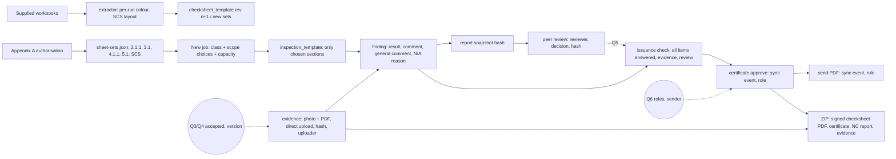

# Change graph: Assure Safety portal upgrade (scope of work, 19 October 2026)

Source: Tatenda Katai (Assure Safety), email of 19 Oct 2026, "Assure Safety Portal
Scope of Work", with `Scope of Work_Assure Safety Online Work Platform.docx` and five
completed workbooks (this folder). Commercials are between Bryan and Ernest and are not
covered here. Method: graph approach. Status: **steps 1–5 drafted; questions sent;
nothing built.**

Programme in the scope: 14 calendar days from the agreed start date (week 1 configure and
develop, week 2 test, correct and accept). Demonstration, user instructions and written
acceptance by Assure Safety's project lead. Changes to scope, cost or date need written
agreement.

## 1. The asks

| # | Ask (scope wording, short) |
|---|---|
| C1 | Add the checksheets Assure Safety supplies, within the limits of Appendix A |
| C2 | Accept **PDFs and photos** as evidence, **showing the version assessed** |
| C3 | Require **authorised peer sign-off** where applicable. For existing SCS, a 17.91 report may be issued only after an authorised certifier peer-reviews it; **link the approval to the report version reviewed** |
| C4 | Restrict certificate **approval** and **sending** to approved roles, and **record both actions** |
| C5 | **Download** signed checksheets and accepted evidence **as a ZIP** |
| C6 | **Completion checks** (named in the deliverable title; detail not given) |
| C7 | Demonstrate the three deliverables, give user instructions, fix defects before written acceptance |
| C8 | Respect the exclusions: ship-to-tank lines, vapourisers, installations burning 3.1, burners, tank repair/alteration, design certification, fabricator certification, 17.91(2)(b)(i)/(ii) |
| C9 | Certified handlers: class 6 excluding agrichemicals, the listed fumigants and VTAs, life cycles storage/use/transport/disposal; supplied assessment documents on each person's record |
| C10 | Cylinder importation: separate pathways under 15.16 and UNRTDG 15.3(3); add any missing sheets |

**Authorisation (Appendix A):** TST100250, active 9 May 2022 to 9 May 2027.
- **Location limits:**
  - 2.1.1 packages/cylinders ≤ 2,000 kg
  - 2.1.2 aerosols ≤ 100,000 L **water capacity**
  - 3.1 (seven choices; limit 10,000 L, use 450 L)
  - 4.1.1 packaged ≤ 2,000 kg/L (r10.36)
  - 5.1.1 packages ≤ 30,000 kg/L, stationary ≤ 30,000 L (r12.17)
  - 6/8 packages ≤ 5,000 kg/L (r13.38)
- **SCS:** existing above- and below-ground tanks ≤ 60,000 L per tank, dispensers, process containers.

**Owner's answers already given (Ernest, 19 Oct):**
- **A1.** Results follow the workbooks; the portal aligns with what Assure Safety wants.
- **A2.** An N/A reason is offered but optional.
- **A3.** Class 3.1: the certifier picks the choice(s) at the start and only those sections show. There are sheets for 3.1 in SCS and for use up to 450 L (to be supplied).

**Waits on Tatenda** (questions sent, `QUESTIONS_FOR_TATENDA.md`):
- **Q1.** The missing sheets.
- **Q2.** Is the Argenta file the 4.1.1 sheet?
- **Q3.** Who accepts evidence, and is a replaced file kept?
- **Q4.** What "version assessed" means.
- **Q5.** Peer-review rules and how the reviewer takes part.
- **Q6.** Logins, roles and the sender address.
- **Q7.** Extra completion checks.

## 2. Today (what the system does, with evidence)

| Ask | Today | Where |
|---|---|---|
| C1 sheets | One pipeline: workbook → extract → reconcile → JSON → TS/Dart/SQL seed. A changed template becomes revision n+1, and a published template is immutable | `packages/checksheets/README.md`, `tools/extract-workbook.mjs`, `migrations/003…:243-271` |
| C1 sets | `class_6_8` (authorised), `class_2_3` (**authorisation null, cannot open a job**), `handler_6`, `cylinder_fern`, `cylinder_un`. Fumigant and VTA handlers are planned only | `packages/checksheets/data/sheet-sets.json:4-47` |
| C1 choice | One fixed set per `job.class_key`; no per-job scope choices; `POST /api/jobs` refuses unauthorised sets | `apps/server/src/app.mjs:358-362`; `sync/apply.mjs:66-90` |
| C1 answers | `finding`: pending / compliant / non_compliant / not_applicable / conditional, plus one comment. A non-compliance needs a reason. Overwritten in place (history only in `sync_event`) | `migrations/002…:233-258`; `apply.mjs:94-131` |
| C2 upload | Raw POST, **4 MB**, any MIME type, stored by SHA-256 (DO Spaces / Vercel Blob / disk) | `app.mjs:988` |
| C2 app | **Photos only** (`image_picker`, 2048 px). No document picker, although `evidence_kind` has `document` | `apps/mobile/lib/screens/evidence_capture.dart:69`; `002:41` |
| C2 version | Evidence → finding → item → pinned template revision. No document version and no accepted/rejected state | `apply.mjs:134-173`; `revision-pin.test.mjs` |
| C3 | **No peer review** of any kind: no role, table, stage or sign-off. `inspection.sign` records the declaration/scope signatures, which are tied to no version | `roles.mjs:16-25`; `apply.mjs:209-230` |
| C4 approve | `POST /api/jobs/:id/certificate` is certifier-only and refuses `granted` with open non-compliances. It is **REST, not a sync event**: not in `sync_event`, and the stage transition `actor_id` is NULL. `certificate.job_id` UNIQUE (no re-issue) | `app.mjs:584-621`; `002:344` |
| C4 send | `POST /api/jobs/:id/send`: email via SMTP with an **.html** attachment. Logged in `communication`, not in `sync_event`; no record of which version was sent | `app.mjs:917-945`; `mail.mjs` |
| C5 | Only `certificate.html` and `non-compliance.html` (print CSS). **No PDF, full checksheet report or ZIP** | `app.mjs:709, 910` |
| C6 | `issuance-check` covers the interest declaration, a reason on each non-compliance, no `pending` findings, and open non-compliances. It **misses items with no finding row at all** and checks no signatures, required evidence or review | `app.mjs:555-581`; `003:53-123` |
| Platform | A Vercel function request body is limited to **4.5 MB**, so large PDFs cannot pass through the server | Vercel limits |

## 3. Found while reading (nobody asked)

- **F1. The workbooks carry results in font colour, mixed inside one cell.** There are no comments, dropdowns or formulas. Red marks a finding; green marks compliant or a correction; blue marks a "General comment". The extractor reads one colour per cell, so it is unsafe for these files.
- **F2. Every location sheet's scope text says "classes 6 or 8 … r13.38"** whatever class is assessed. This is copy-paste in the template.
- **F3. The Argenta "Class 2 and 3" file assesses a 4.1.1 substance** on a tab named "Class 3.2 and 4", while its title says "3.4 and 4" (Q2).
- **F4. SAT 201 covers design, construction, fabricator and repair**, which C8 excludes. Its layout (Reg / Requirement / SWI / Comments; tank identity block; Yes/No site-plan tab) is new to the extractor.
- **F5. The Class 3.1 workbook is the Abecca workbook already extracted, revised.** It has regulation corrections (13.34(4)→10.34(1)(a), 13.3→10.34(1)(h), 13.34(5)(b)→10.26(4)(b), 17.91→10.34), so the existing template becomes revision n+1.
- **F6. The 2.1.1 class tab is the same template as `wks17-class-2-and-3-1-substances`**, but `class_2_3` has no authorisation. Appendix A now supplies the authorisation.
- **F7. The Class 5 sample has a certificate tab numbered TST100040-…** (not TST100250) with conflicting dates. These look like mock leftovers, not fields to model.
- **F8. The issuance check passes a job with unanswered items** that have no finding row (§2 C6). This is a real defect regardless of the scope.
- **F9. Certificate issue and send are not in the audit trail** (`sync_event`), and the stage transition has no actor. C4's "record both actions" is not met today.
- **F10. The hash-chained `event` table exists but nothing writes to it.**

## 4. The graph

| Ask | Change | Size | Waits on |
|---|---|---|---|
| C1 | Extract 2.1.1, 3.1 (rev), 5.1.1/5.1.2 with per-run colour parsing. Add authorisation entries from Appendix A (`class_2_3` split into 2.1.1 / 3.1; new 5.1, 4.1.1, SCS sets). Record capacity/quantity per job against the limits | M | Q1, Q2 for 4.1.1 / 2.1.2 / SCS sheets |
| C1 / A3 | **Scope choices per job**: the 3.1 choices (and SCS: existing AG/BG tank, dispenser, process container) chosen at job start; only the chosen sections are pinned and shown | M | sheets for 3.1-SCS and use ≤ 450 L |
| C1 / A1 | Result + comment + **general comment** (blue) per item. Printed output coloured as in the workbooks. Optional N/A reason (A2) | S | — |
| C2 | Document picker (PDF) and photos. **Direct-to-storage upload** for large files (Blob client upload / Spaces presigned), the server records the hash. Evidence keeps uploader, time and file hash; replacement adds a new row | M | Q3, Q4 for "accepted" and "version" |
| C3 | `review` record: reviewer, decision, comment, **report snapshot hash** reviewed. Edits after approval lapse it. Issue is blocked where review is required and missing | M | Q5 |
| C4 | Certificate approve and send become sync events (in `sync_event`, with the person). Stage transition actor filled. Send attaches a **PDF**. Role rules from Q6 | S–M | Q6 |
| C5 | Server-side PDF of the completed checksheet (signed: name, date, authorisation number, signature image) plus certificate, NC report and accepted evidence → **ZIP**, files named by appendix | M | — (contents fixed by the scope) |
| C6 | Issuance check also counts unanswered items (F8), required evidence, and review where applicable; more from Q7 | S | Q7 |
| C9 / C10 | Handler fumigants/VTA sets and the life cycles; cylinder sheets already exist, so add only what is missing | S | supplied documents |

Readers to keep in step when `finding` / `evidence` / sets change:
- Server: `/api/jobs`, `/api/jobs/:id`, dashboard reminders, issuance check, `certificate.html`, `non-compliance.html`, `/send`, `/api/jobs/import`.
- App: the job hub, the checksheet screen, the evidence capture screen.
- Tests: `fake_server.dart`, the revision-pin tests.

## 5. Decisions (each reversible)

- **B1. Results follow the workbooks (A1).** Each item stores a result (compliant / non-compliant / N/A) and a comment, plus a separate general comment. The printed checksheet uses the workbook colours (green compliant, red finding, blue general comment).
  - **Why:** the owner's instruction. An explicit result is what the issuance check needs.
  - **Reverse:** drop the general-comment column; the colours live only in the renderer.
- **B2. The N/A reason is optional (A2):** a field, never a blocker.
- **B3. Class 3.1 (and SCS) choices are picked at job start (A3).** Only those sections are pinned. Sections not chosen do not appear and do not count as unanswered.
  - **Reverse:** pin the whole set again.
- **B4. Excluded work (C8) shows as "not in scope"** where a supplied sheet contains it (SAT 201 design/construction/fabricator/repair). It never counts toward a certificate and cannot be chosen.
- **B5. The scope text prints the regulation of the class assessed** (10.34, 10.36, 12.17, 13.38, 17.91), not "6 or 8 / 13.38" (F2).
- **B6. Aerosol water capacity is a job detail** (beside quantity), checked against the 100,000 L limit.
- **B7. Large files upload straight to storage.** The server records the hash and metadata, not the bytes, so PDFs are not limited to 4.5 MB.
- **B8. Peer approval is tied to a hash of the report as reviewed.** Any later change to findings or evidence lapses it (scope: "link that approval to the report version reviewed").
- **B9. Certificate approve and send become audited sync events** (F9), each recording the person and the certificate version sent.
- **B10. The ZIP holds** the signed checksheet PDF, certificate, NC report and accepted evidence, named by appendix as in the workbooks. "Signed" means name, date, authorisation number and the signature image.
- **B11. The WorkSafe notification stays manual** (not in scope).
- **B12. F8 (unanswered items pass the issuance check) is fixed in phase 1** as a defect.
- **B13. Mock leftovers are not modelled** (F7, "XX/XX/202X", "xxxxxxx", copy-pasted phone numbers).

## 6. Phases

- **Phase 1: safe now, no answers needed.**
  - PDF evidence and direct upload (B7). Evidence history kept; the acceptance state waits on Q3.
  - Per-run colour extractor (F1).
  - Extract 2.1.1, 3.1 rev, 5.1.1/5.1.2.
  - Sets and authorisation from Appendix A.
  - General comment and optional N/A reason.
  - 3.1 scope choices for the sheets in hand.
  - Issuance check fix (F8).
  - Approve/send as audited events (F9).
  - Checksheet PDF and ZIP.
  - Scope text per class (B5).
- **Phase 2: on Tatenda's answers.**
  - 4.1.1 (Q2), 2.1.2, SCS existing tanks / dispensers / process containers, 3.1-SCS and use ≤ 450 L (Q1).
  - Evidence acceptance and version (Q3, Q4).
  - Peer review (Q5).
  - Roles and sender (Q6).
  - Extra completion checks (Q7).
- **Phase 3:** demonstration, user instructions, defect fixes, written acceptance.

The 14 days start on the agreed date. Phase 2 depends on the sheets arriving in week 1. If they don't, the date moves by written agreement (as the scope says).

## 7. Built (phase 1, 19 October 2026; local, committed on feat/graph-model, NOT pushed or deployed)

Built as four packages in parallel (contract: `PHASE1_CONTRACT.md`), then hardened after an independent review.

| Piece | Where |
|---|---|
| Migration 013: general comment, N/A reason, `job.scope_choices`, `inspection_section_excluded`, `evidence.original_name`, views `inspection_item_in_scope` / `finding_in_scope`; issuance guard refuses unanswered in-scope items (F8) and ignores excluded sections | `packages/db/migrations/013_scope_of_work_1019.sql` |
| Appendix A authorisations (8 entries with limits; C8 exclusions as text); `class_2_3` authorised through 8 scope choices (2.1.1, 2.1.2, six 3.1 arrangements; section 18 shared by use and workroom); new `class_5_1`; 4.1.1, 3.1-in-SCS, use ≤ 450 L and SCS listed as planned | `packages/checksheets/data/*`, `CHOICES.md` |
| Templates: `wks17-class-2-and-3-1-substances` rev 2 and `wks17-general` rev 2 (r10.34 corrections, F5); new `wks17-class-5-1-1-and-5-1-2` (scope r12.17, B5); extractor reads colour per run, blue "General comment" → `generalComment` | `packages/checksheets` |
| Scope choices: validated at New job (IPS 8), sections excluded at inspection open, hidden in the app and out of every count | `apps/server/src/scope.mjs`, `sync/apply.mjs`, app |
| General comment (blue) and optional N/A reason, in the item editor and wide sheet; workbook colours on comments | app, `finding.upsert` |
| Evidence: PDFs and photos (JPEG/PNG/PDF only, 50 MB); direct-to-storage presigned PUT with server re-hash on confirm; short-lived links; never overwrites or deletes evidence on record; keys content-addressed only | `app.mjs` evidence block, `evidence_capture.dart`, `api_client.dart` |
| Checksheet PDF (workbook layout, class view, colours, evidence names, declaration, scope, signature block) and job ZIP (PDF, certificate, NC report, evidence named by appendix; 150 MB cap) | `apps/server/src/export/**`, job screen buttons |
| Certificate issue and send in the audit trail by person; stage move names its actor (F9) | `app.mjs` |
| `Referrer-Policy: no-referrer` on every response | `app.mjs` |

## 8. Proof (19 October 2026, local only; nothing deployed, live untouched)

- Tests first where the code was mine (server scope test seen red 8 of 10; hardening 11 of 11 red, including the path-traversal one, which really bundled a file outside the store).
- **Server:** 13 suites, all green (api.e2e 29, revision-pin 5, process-flow 10, auth 8, loops 10, forms 6, users 6, review 9, clients 15, scope 13, evidence 14, export 12, hardening 13). **packages/db:** 4 suites green (PGlite). **Flutter:** 95 passed, 2 skipped (live); analyze: the 2 pre-existing notices.
- **Independent review** (code reviewer): 2 high, 5 medium, 2 low. Fixed with tests: key traversal into the ZIP, overwrite/delete of stored evidence, unsigned Spaces size, size-before-hash, omitted fields wiping stored ones, excluded sections still blocking, Flutter denominator, ZIP extension, Referer. Bundle memory capped (150 MB, 413).
- **Browser walk** (local server, PGlite): New job → class 2/3.1 → scope chips (Create waits for one) → cabinet-only sheet shows sections 1, 2, 3, 10, 11, 12 (43 items) → N/A with reason, general comment → job card "1 of 43" → Checksheet PDF. Found and fixed on the walk: the New job dialog stretched full width; typed text could be wiped by a rebuild mid-typing (pre-existing, also Comments); the PDF printed the class 6/8 regulations on a class 2/3.1 job. PDF evidence upload, ZIP and link walked through the API (disk mode).
- **Not verified:** real Vercel Blob / DO Spaces presigned PUT and GET (only fakes); browser CORS for a direct PUT to Blob, and the Spaces bucket CORS rule; pdfkit fonts in the Vercel bundle; ZIP time on a large job inside 30 s; a real iPad; the file picker in a real browser (the walk could not drive the OS dialog).

## 9. Open

- Q1–Q7 (sent to Tatenda on 19 Oct).
- Not built yet in phase 1: B6 aerosol water capacity on the job (and quantity checks against the Appendix A limits); SAT 201 extraction; certificate as PDF (waits Q6); a short-lived download token instead of the session token in `?token=` links (Referrer-Policy added meanwhile); clean-up of old `exports/` ZIPs.
- For Bryan/Tatenda, from the checksheet extraction (`packages/checksheets/data/CHOICES.md`):
  1. Section 10 (3.1 transfer points) always shows: right, or only under some choices?
  2. The class 5 general sheet still cites 13.34(5)(b) and the class 6/8 secondary-containment list: class 5 regulations wanted?
  3. Appendix A authorises 5.1.1; the sheet and its scope say "5.1.1 or 5.1.2": which?
  4. Class 2/3.1 section 14 cites "11.3": is that 11.30?
- Before deploy: run the new routes once against a Vercel preview with the real Blob store (upload a PDF over 4.5 MB, open its link, download a ZIP), and check the browser accepts the direct PUT.
- Earlier open items for Bryan:
  - archive the demo clients on live
  - Argenta job 20 vs job 1
  - legal vs trading name
  - archive blocking writes (B8 of 16 Oct)

## 10. Answers (Tatenda Katai, 20 October 2026) and what they change

| Q | Answer (short) | Changes |
|---|---|---|
| Q1 sheets to come | 2.1.2 aerosols, existing AG/BG tanks, dispensers, process containers: being prepared, will be sent | Nothing to build until they arrive. The extraction pipeline is ready (one JSON per sheet, revision n+1). |
| Q2 Argenta file | The "Class 3.2 and 4" tab is a general sheet for **3.2, 4.1.1, 4.1.2A–F**; the example assessed a 4.1.1 substance | **New sheet set** `class_3_2_4` from that tab (r10.36). Check the authorisation entry: Appendix A lists 4.1.1 only (≤ 2,000), so 3.2 and 4.1.2A–F substances need a confirmation before the set offers them (reg 6.22(1)). |
| Q3 accepted evidence | The **reviewer** assesses and accepts evidence that shows compliance; replaced files are **kept** | Evidence gets a state (submitted / accepted / not accepted) set by a reviewer, with who and when. Replacing a file adds a version, never deletes the old one. |
| Q4 version assessed | Record the **upload date** (and keep previous versions); the version used must be **identified in the downloaded package** | Evidence versions: `supersedes` link, uploaded_at/by. The checksheet PDF and ZIP name the version that was accepted ("v2, uploaded 20/10/2026 by …"); older versions go in a "previous versions" folder. |
| Q5 peer review | Only for **SCS on a 17.91 report**. The peer reviewer has **separate access**: sees only the final check sheets and evidence, comments, and **formally approves** in a peer-review section | New role `peer_reviewer` (read-only to the job's sheets and evidence + comments + approve). A `peer_review` record (reviewer, decision, comment, snapshot hash). Issue blocked for SCS/17.91 jobs until approved; edits after approval lapse it. |
| Q6 roles and sending | Being finalised. **Six people**: two may issue (all certificates in **Bryan Wilson's name**), three reviewers (one with admin and oversight), one peer reviewer (changes over time, own login). Sender address: not yet answered | Roles: `certifier` (2), `reviewer` (3, one with `admin`), `peer_reviewer` (1). The second issuer signs in as themselves; the certificate still names Bryan Wilson (TST100250) as certifier, and the audit trail records who actually issued it. Send address waits. |
| Q7 completion checks | A conditional certificate must **state the deadline**; the assessment **stays open** until every condition is met and **approved by the certifier** | Deadline: **built 20 Oct** (below). Open-until-met: the job stays in a "conditions outstanding" state after a conditional issue; each condition is verified by a certifier; the job closes only when all are verified, with a reminder before the deadline. |

### Built 20 October 2026 (with the owner's go)

- **Certificate wording follows the decision and the class** (`packages/checksheets/lib/render-certificate.mjs` `locationWording`, `CLASS_REGULATION`): granted = reg 6.23 + class regulation (2/3.1 → 10.34, 5.1 → 12.17, 6/8 → 13.38); conditional = reg 6.24, "with the exception of the requirements set out below, which must be met by <date>"; refused = **notice of refusal** under reg 6.23(2), no in-force or expiry date, never "have been met".
- **Conditions deadline** (Q7, reg 6.24(2)): migration `014_conditions_due.sql` (nullable column + check ≤ 3 months); the issue route requires it for a conditional decision (422, clause reg 6.24(2)); the Issue dialog offers it (default: the latest allowed); the job shows it.
- **Requirements not met** are filled from the open non-compliances when none are typed ("General 4.4 (reg 2.6(3)): reason"), so a conditional certificate or refusal never says "None".
- **13.3 → 13.30** on the class 6/8 secondary-containment item (general template rev 3). Inspections already open keep the revision they started on.
- Proof: new `apps/server/test/certificate-wording.test.mjs` (9 steps); all 14 server suites, 4 db tests, 144 Flutter tests green.

### Still open after the answers

1. Sender address for certificates (Q6, pending).
2. The full list of the six people and their emails (Q6, pending).
3. Authorisation for 3.2 and 4.1.2A–F (Appendix A has 4.1.1 only) before the class 3.2/4 set offers them.
4. From the regulatory check: the refusal notice to WorkSafe (IPS cl 11, 15 working days, 13 fields), renewal period by class, Appendix A quantity limits, register entry date; 11.3 → 11.30 and 13.34(5)(b) → 12.8(5)(b) on the class 2/3.1 and 5.1 sheets.

### Phase 2 (ready to build on the owner's go)

- P2-A evidence review and versions (Q3, Q4) · P2-B peer reviewer role and approval for SCS/17.91 (Q5) · P2-C roles: second issuer, reviewer admin (Q6) · P2-D conditions outstanding until verified (Q7) · P2-E class 3.2/4 sheet set from the Argenta tab (Q2).
